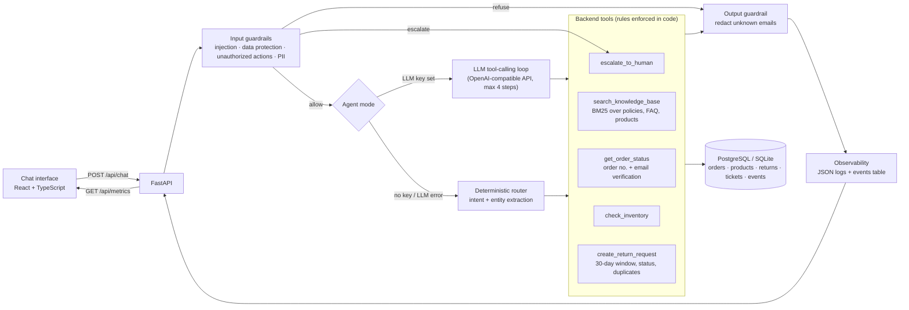

# Architecture

## Request flow

1. **Input guardrails** (`app/guardrails.py`) run first in both modes. Prompt-injection attempts, requests for other customers' data, card numbers or passwords, and actions the assistant is not allowed to take (discounts, price changes, refunds without a return) are refused **before any tool runs**. Requests for a human, legal threats and very upset customers create a support ticket.
2. **Agent** (`app/agent.py`):
   - **LLM mode** sends the conversation and the tool schemas to an OpenAI-compatible model. The model chooses tools; the server executes them and returns the results. An extra check stops the model from using an order number or email that the customer never typed.
   - **Rules mode** classifies the intent, extracts the order number, email and return reason from the conversation (so details can arrive over several messages) and calls the same tools. It is used when no API key is set, in CI, and automatically if an LLM call fails (`mode: rules-fallback`).
3. **Tools** (`app/tools.py`) hold the business rules: identity verification, the 30-day return window, return fees, no second return, and the 500,000 KRW manual-review limit. A wrong email and a non-existent order return the same message, so order numbers cannot be probed.
4. **RAG** (`app/rag/retriever.py`): Markdown documents are split at `##` headings and ranked with BM25. Policy answers quote the best-matching section and cite it (`shipping.md#International shipping`). BM25 needs no external service and gives reproducible tests; the `Retriever` class can be swapped for pgvector or Chroma embeddings.
5. **Output guardrail** removes any email address the customer did not provide.
6. **Observability** (`app/observability.py`): every turn is written as a JSON log line and an `events` row with intent, mode, tools (name, success, latency, error code), refusal, escalation, total latency and a masked message preview. `GET /api/metrics` aggregates these into p50/p95 latency, tool usage and failure counts, refusal and escalation rates.

## Data

All data is synthetic: a fictional outdoor store, 10 customers with `@example.com` emails, 15 products and 30 orders. Orders `OP-1001` to `OP-1010` are hand-made scenarios (eligible return, expired window, in transit, already returned, processing, cancelled, last day of the window, one day too late). Dates are generated relative to start-up time, so the scenarios stay valid.
